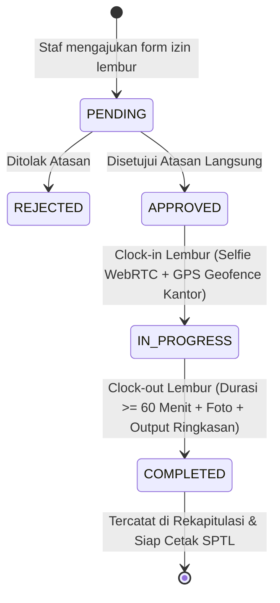

# DOKUMENTASI PEROMBAKAN ARSITEKTUR & FITUR TERBARU
**OutsourceTrack & KPI Pro — Dinas Pendidikan Kabupaten Hulu Sungai Tengah**  
*Tanggal Rilis / Pemutakhiran: 8 November 2026*  
*Status: Terverifikasi & Terintegrasi di Database SQLite + UI Client*

---

## 1. Ringkasan Eksekutif Perombakan

Perombakan sistem pada fase November 2026 berfokus pada 5 pilar utama:
1. **Engine Lembur Kedinasan (Overtime Pro) & Format Cetak SPTL**: Menstandarkan pengajuan, validasi geofence, durasi sah minimal, dan cetak Surat Perintah Tugas Lembur sesuai aturan keuangan daerah.
2. **Skema Presensi Penjaga Malam (Wakar) Lintas Hari (*Cross-Day Overnight Shift*)**: Menyelesaikan anomali pergantian hari kalender (pukul 00:00 WITA) agar clock-in malam dan clock-out pagi keesokan harinya terhubung dalam satu sesi kerja utuh tanpa terkena auto-close tengah malam.
3. **Konfigurasi Identitas Instansi & Kop Surat Dinamis (Multi-SKPD Replicable)**: Mengubah hardcode instansi menjadi sistem dinamis berbasis database SQLite, memungkinkan aplikasi direplikasi dengan mudah untuk SKPD lain (Dinas Kesehatan, RSUD, Setda, dll).
4. **Scoping Otoritas & Hirarki Supervisor (RBAC)**: Menghubungkan staf dengan atasan langsung (*supervisor*) secara spesifik di database SQLite sehingga supervisor hanya dapat mengawasi, menyetujui lembur, dan menilai staf yang berada di bawah unit kerjanya.
5. **Inspeksi Terpadu Riwayat Kehadiran (Leaflet Geo-Map & Anti-Freeze)**: Unifikasi modal inspeksi presensi dengan koordinat peta interaktif untuk presensi masuk, istirahat, dan pulang tanpa kendala *DOM unmount freeze*.

---

## 2. Rincian Modul & Implementasi Teknis

### Modul A: Engine Lembur Resmi (Overtime Pro) & Cetak SPTL

#### 1. Latar Belakang & Aturan Kedinasan
Sesuai standar audit dan pertanggungjawaban keuangan daerah, pelaksanaan lembur oleh tenaga alih daya (outsourcing) memiliki syarat ketat:
- Lembur **wajib** dilaksanakan di dalam radius kantor dinas resmi (terverifikasi geofence GPS).
- Lembur **wajib** disetujui terlebih dahulu oleh Pejabat Pengawas / Atasan Langsung sebelum presensi lembur dapat dimulai.
- Durasi lembur yang sah dan dapat dibayarkan minimal **60 menit (1 Jam)**. Sistem menolak clock-out jika durasi kurang dari 60 menit.
- Staf **wajib** menyertakan foto selfie bukti kerja di kantor dan ringkasan output hasil kerja (*work summary*).

#### 2. Alur Kerja (Workflow State Machine)


#### 3. Skema Database SQLite (`overtime_requests`)
File: `server/db.js`
```sql
CREATE TABLE IF NOT EXISTS overtime_requests (
  id TEXT PRIMARY KEY,
  staff_id TEXT NOT NULL,
  staff_name TEXT NOT NULL,
  staff_nip TEXT,
  division_id TEXT NOT NULL,
  division_name TEXT,
  supervisor_id TEXT NOT NULL,
  supervisor_name TEXT,
  date TEXT NOT NULL,
  start_time_plan TEXT,
  estimated_hours REAL,
  reason TEXT NOT NULL,
  status TEXT DEFAULT 'PENDING', /* PENDING, APPROVED, REJECTED, IN_PROGRESS, COMPLETED */
  supervisor_notes TEXT,
  approved_at TEXT,
  clock_in_time TEXT,
  clock_in_selfie_url TEXT,
  clock_in_coords TEXT,
  clock_out_time TEXT,
  clock_out_selfie_url TEXT,
  clock_out_coords TEXT,
  actual_duration_minutes INTEGER DEFAULT 0,
  work_summary TEXT,
  created_at TEXT NOT NULL,
  updated_at TEXT NOT NULL
);
```

#### 4. REST API Endpoints Backend
File: `server.js`
- `POST /api/overtime/request` : Mengajukan izin lembur baru.
- `GET /api/overtime` : Mengambil daftar tiket lembur (filter by `staffId`, `supervisorId`, `date`, `status`).
- `PATCH /api/overtime/:id/approve` : Persetujuan atau penolakan oleh supervisor dengan catatan arahan.
- `POST /api/overtime/:id/start` : Clock-in lembur berbasis selfie WebRTC dan koordinat GPS.
- `POST /api/overtime/:id/finish` : Clock-out lembur dengan validasi durasi minimal 60 menit dan catatan output.

#### 5. Modul Cetak Dokumen Kedinasan (SPTL)
File: `src/components/PrintReportModal.tsx`
- Menambahkan tab switcher cetak: `rekap-divisi`, `rapor-staf`, dan `sptl-lembur`.
- Mode `sptl-lembur` menghasilkan format resmi: **Surat Perintah & Rekapitulasi Pelaksanaan Tugas Lembur (SPTL)**.
- Dilengkapi nomor surat dinamis, rincian dasar kedinasan, tabel staf penerima tugas, durasi sah, deskripsi tugas, serta kolom tanda tangan pejabat penandatangan definitif.

---

### Modul B: Skema Presensi Jaga Malam (Wakar) Lintas Hari

#### 1. Masalah yang Diselesaikan
Petugas jaga malam (Wakar) bekerja dengan jam lintas hari:
- **Clock-In**: Malam hari (19:30 – 21:00 WITA, tanggal $D$).
- **Clock-Out**: Pagi hari (05:30 – 07:00 WITA, tanggal $D+1$).
Pada sistem standar, pergantian tanggal pukul 00:00 menyebabkan mekanisme *auto-close midnight* menganggap sesi tanggal $D$ tertinggal tanpa clock-out, dan saat staf ingin absen pulang di tanggal $D+1$, sistem mencari catatan masuk di hari yang sama sehingga terjadi error/anomali.

#### 2. Solusi Teknis
1. **Pengecualian Auto-Close**:
   Fungsi auto-close di backend (`server/db.js`) mengecualikan akun dengan peran/posisi `Wakar` atau `Jaga Malam`.
2. **Prioritasi Shift Malam Hari Kemarin (H-1)**:
   Saat staf wakar menekan tombol clock-out di pagi hari, sistem memeriksa:
   - Apakah terdapat absensi berstatus aktif (tanpa clockOutTime) pada tanggal $D-1$.
   - Jika ada dan waktu saat ini berada dalam jendela subuh/pagi, sistem mengaitkan clock-out tersebut ke record tanggal $D-1$.
3. **Konfigurasi Khusus Wakar di Jadwal Kerja**:
   Ditambahkan interface `wakarSchedule` di `DEFAULT_ATTENDANCE_SETTINGS`:
   ```typescript
   wakarSchedule: {
     enabled: true,
     dayName: 'Jaga Malam / Wakar',
     clockInStart: '19:30',
     clockInEnd: '21:00',
     clockOutStart: '05:30',
     clockOutEnd: '07:00'
   }
   ```

---

### Modul C: Identitas Instansi & Kop Surat Dinamis (Multi-SKPD)

#### 1. Latar Belakang & Fleksibilitas Replikasi
Aplikasi OutsourceTrack dirancang agar dapat digunakan oleh seluruh Satuan Kerja Perangkat Daerah (SKPD) di lingkungan Pemkab HST tanpa mengubah source code (*zero code customization*).

#### 2. Data Struktur & Konfigurasi Default
File: `src/types/index.ts`
```typescript
export interface InstitutionSettings {
  namaPemda: string;
  namaSkpd: string;
  singkatanSkpd: string;
  alamatLengkap: string;
  website: string;
  email: string;
  telepon: string;
  kotaSurat: string;
  nomorSuratPrefix: string;
  logoKiriUrl: string;
  logoKananUrl: string;
  pejabatNama: string;
  pejabatNip: string;
  pejabatJabatan: string;
}
```

#### 3. Default Preset Dinas Pendidikan Kab. HST
- **Pemda**: `PEMERINTAH KABUPATEN HULU SUNGAI TENGAH`
- **SKPD**: `DINAS PENDIDIKAN` (`DISDIK`)
- **Alamat**: `Jalan H. Sibli Imansyah No. 1 RT 06 RW 02 Barabai, Kab. HST 71315`
- **Prefix Nomor Surat**: `800.1 / OTP-DISDIK`
- **Logo Kiri**: `/logos/Lambang_Kabupaten_Hulu_Sungai_Tengah.png`
- **Logo Kanan**: `/logos/logo-disdik2026.png`
- **Pejabat Penandatangan**: `Salihin, S.Pd.SD` (Sekretaris Dinas Pendidikan)
- **NIP**: `19780502 200604 1 017`

#### 4. UI Pengaturan & Penyimpanan
- Tab baru **Identitas & Kop Surat** di `SystemSettingsView.tsx`.
- Disimpan di database SQLite tabel `system_settings` key `institution_identity`.
- Terintegrasi langsung ke kop surat laporan evaluasi, rekap kehadiran bulanan, dan dokumen SPTL.

---

### Modul D: Scoping Otoritas Supervisor & Sinkronisasi Langsung SQLite

#### 1. Pengawasan Berbasis Hierarki
- Sebelumnya, supervisor dapat melihat seluruh staf di aplikasi.
- Sekarang, supervisor difilter hanya melihat staf yang ditugaskan di bawah kewenangannya (`staff.supervisorId === currentUser.id` atau `currentUser.nip`).
- Hak akses menu sidebar (RBAC) bagi Supervisor dibatasi secara ketat: hanya dapat mengakses dashboard evaluasi, feed laporan kerja harian staf binaan, dan tiket lembur staf binaan.

#### 2. Sinkronisasi SQLite
Kolom `supervisor_id` di tabel `users` disinkronkan secara langsung via endpoint `/api/admin/supervisor-mapping` sehingga pemetaan atasan-bawahan bersifat permanen dan konsisten di seluruh sesi.

---

### Modul E: Peningkatan UI Inspeksi Kehadiran & Evaluasi Kinerja

1. **DetailRiwayatModal Terintegrasi**:
   - Memadukan koordinat GPS ke peta Leaflet interaktif.
   - Switcher tab untuk verifikasi: Jam Masuk (selfie WebRTC + akurasi meter), Istirahat, Jam Pulang, dan Bukti Tugas Lapangan.
   - Mencegah memory leak atau freeze pada Leaflet container ketika modal dibuka-tutup berulang kali.
2. **Default Skor Evaluasi 1 Bintang**:
   - Menghindari skor `0` atau `null` pada kalkulasi radar chart 4 pilar yang dapat merusak visualisasi SVG/Canvas spider chart.


---

### Modul F: Manajemen Izin, Cuti & Sakit Terpadu (Smart Leave Pro)

#### 1. Latar Belakang & Tata Kelola Kepegawaian
Staf alih daya (outsourcing) memiliki hak atas izin sakit (berdasarkan surat dokter/SKD) dan hak cuti tahunan (12 hari kerja per tahun). Sebelumnya, izin dicatat manual atau tidak terintegrasi dengan mesin presensi, sehingga staf berisiko ditandai sebagai `Alpha` atau memicu alarm geofence.

#### 2. Fitur Unggulan Sistem
1. **Sinkronisasi Presensi Otomatis**: Saat atasan menyetujui (`APPROVED`), sistem secara otomatis menginjeksi rekam kehadiran pada rentang tanggal terkait ke database SQLite dengan status `'Sakit'` atau `'Izin'`.
2. **Hybrid Lampiran Bukti Medis**: Staf dapat mengambil foto fisik surat dokter secara langsung menggunakan WebRTC Camera (ber-watermark) atau mengunggah berkas foto/PDF resmi hingga 5MB.
3. **Visual Kuota Cuti Tahunan**: Pelacakan saldo hak cuti secara real-time (total 12 hari, cuti terpakai, sisa hari, serta akumulasi izin sakit).
4. **Sub-Tab Verifikasi Supervisor**: Filter status permohonan, badge tiket pending, inspeksi berkas SKD/PDF interaktif, dan aksi persetujuan/penolakan dengan catatan arahan.
5. **Cetak Surat Keterangan Izin/Cuti Resmi**: Format naskah dinas kedinasan resmi Pemkab HST & Disdik dengan nomor surat dan tanda tangan definitif Sekretaris Dinas Pendidikan (`Salihin, S.Pd.SD`).

#### 3. Database & REST Endpoints
- Tabel SQLite: `leave_requests` (kolom: `id`, `staff_id`, `leave_type`, `start_date`, `end_date`, `total_days`, `reason`, `attachment_url`, `status`, `supervisor_notes`, dll).
- REST API: `POST /api/leave/request`, `GET /api/leave`, `PATCH /api/leave/:id/approve`, dan `GET /api/leave/quota/:staffId`.
---

## 3. Log Riwayat Commit Git (Fase November 2026)

| Commit Hash | Tanggal | Tipe | Deskripsi Perubahan |
| :---: | :---: | :---: | :--- |
| `515493e` | 2026-11-08 | `fix` | Impor komponen ikon `X` dari `lucide-react` untuk modal pengajuan lembur di `StaffHomeView`. |
| `04fccd9` | 2026-11-08 | `feat` | Implementasi penuh modul tugas lembur resmi: verifikasi geofence, persetujuan atasan, durasi $\ge 60$ menit, dan cetak SPTL. |
| `f71f8f3` | 2026-11-08 | `fix` | Skema presensi wakar lintas hari, proteksi auto-close midnight, dan algoritma prioritasi shift malam H-1. |
| `ca8bef7` | 2026-11-08 | `feat` | Modul pengaturan identitas instansi & kop surat dinamis untuk replikasi multi-SKPD. |
| `7fe08dc` | 2026-11-08 | `fix` | Standarisasi logo resmi daerah/dinas, penandatangan riil (Sekretaris Disdik), dan skor default 1 bintang. |
| `771aa85` | 2026-11-08 | `fix` | Perbaikan `ReferenceError: staff is not defined` pada feed laporan kerja supervisor. |
| `e33c12a` | 2026-11-08 | `fix` | Sinkronisasi relasi atasan-bawahan langsung ke database SQLite (`supervisor_id`). |
| `ca527b9` | 2026-11-07 | `feat` | Scoping daftar staf berdasarkan atasan, pembatasan hak sidebar supervisor, dan default nilai evaluasi. |
| `2ee1ded` | 2026-11-07 | `fix` | Perbaikan klik sub-tab clock-out modal agar tidak me-reset state dan mencegah freeze Leaflet. |
| `e2a4215` | 2026-11-07 | `fix` | Penanganan catatan informatif pada data presensi lama yang belum memiliki snapshot pulang. |
| `6336754` | 2026-11-07 | `feat` | Unifikasi modal inspeksi admin dengan `DetailRiwayatModal` lengkap dengan peta Leaflet. |

---

## 4. Panduan Verifikasi & Pengujian Sistem

1. **Uji Coba Pengajuan Lembur**:
   - Login sebagai akun staf pengujian: `Musuwarahmi` (NIP: `19821218`).
   - Buka menu Beranda Staf $\rightarrow$ Klik tombol **Ajukan Lembur**.
   - Isi estimasi jam, tanggal, dan alasan kedinasan mendesak $\rightarrow$ Kirim.
   - Login sebagai Atasan/Supervisor $\rightarrow$ Buka tab **Tiket Lembur** $\rightarrow$ Klik **Setujui**.
   - Kembali ke akun staf $\rightarrow$ Mulai lembur dengan kamera WebRTC terverifikasi geofence.
2. **Uji Coba Presensi Wakar**:
   - Akun staf wakar melakukan clock-in pada pukul 20:00 WITA.
   - Pastikan cron auto-close tengah malam tidak menutup sesi tersebut.
   - Pukul 06:00 pagi berikutnya, klik tombol Clock-Out $\rightarrow$ Sesi masuk malam kemarin berhasil diakhiri secara valid.
3. **Uji Coba Cetak Dokumen**:
   - Buka modal cetak laporan $\rightarrow$ Pilih mode **SPTL Lembur** $\rightarrow$ Pastikan kop surat dan rincian instansi tampil sesuai konfigurasi dinamis.
